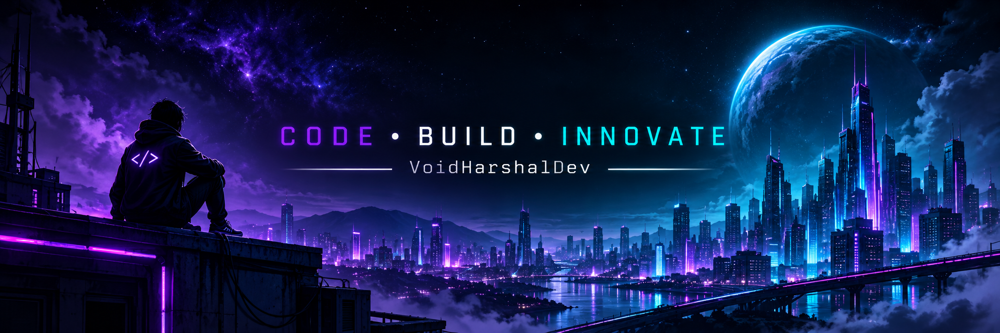

<!-- Profile README for VoidHarshalDev -->

 

# Hey there! I'm Harshal 👋

### AI/ML Developer · Computer Science Student · Building Intelligent Systems

---

## 🧑‍🚀 About Me

- 🎓 Third-year Computer Science student specializing in **Artificial Intelligence & Machine Learning** at **Smt. Indira Gandhi College of Engineering (SIGCE)**.
- 🤖 Interested in **Artificial Intelligence, Machine Learning, Computer Vision, Generative AI, LLMs and AI Agents**.
- 🔬 Completed an **LLM Research Internship** with the AI & ML Research Division at SIGCE.
- ⚙️ Explored distributed CPU-based LLM inference using **Ray, Hugging Face Transformers, Linux and Kubernetes**.
- 🧠 Enjoy turning technical concepts into practical systems that address real-world problems.
- 🚀 Interested in hackathons, collaborative development and continuously improving my engineering skills.

## 🧰 Tech Stack & Areas of Interest

### 💻 Programming & Development

  
  
  
  
  

### 🧠 AI, Machine Learning & LLMs

  
  
  
  
  
  
  

### 🛠️ Tools & Frameworks

  
  
  
  
  
  
  

## 🚀 Featured Project

### 🧑‍🤝‍🧑 Smart Attendance System Using Facial Recognition

A collaborative AI-powered attendance management system built to streamline attendance tracking through real-time facial recognition and computer vision.

**Tech:** Python · Flask · OpenCV · Face Recognition · SQLite · HTML · CSS

**Highlights**
- 📸 Real-time face registration and recognition.
- ✅ Automated attendance recording.
- 🗓️ Timetable-based subject identification.
- 🧑‍💼 Role-based dashboards.
- 📊 Attendance analytics and monthly tracking.
- 📁 Excel attendance reports and exports.
- ⚠️ Alerts for attendance below the 75% threshold.

## 🔬 Experience & Research

### LLM Research Intern
**AI & ML Research Division — Smt. Indira Gandhi College of Engineering (SIGCE)**

*May 2026 – July 2026*

Explored approaches for running Large Language Models across distributed CPU-based systems, with a focus on inference workflows and performance.

- ⚙️ Experimented with multi-node LLM inference using **Ray**.
- 🤗 Worked with **Hugging Face Transformers** and open-source language models.
- 🧪 Explored models including **TinyLlama, GPT-2, Phi-2 and Qwen**.
- 🐧 Worked in Linux-based distributed computing environments.
- ☸️ Explored Kubernetes for infrastructure monitoring.
- 📈 Studied inference latency, throughput and system performance.

## 🌌 Leadership & Community

### Student Coordinator — Ad Astra
**AI & ML Department Club, SIGCE**

- 🎯 Event coordination and organization.
- 📝 Technical and event documentation.
- 🤝 Supporting departmental activities.
- 🌱 Student engagement and coordination.

## 📊 GitHub Activity

## 🌱 What I'm Exploring

- 🧠 Artificial Intelligence & Machine Learning
- 👁️ Computer Vision
- 💬 Large Language Models
- ✨ Generative AI
- 🤖 AI Agents
- 📚 Retrieval-Augmented Generation (RAG)
- 🔌 Model Context Protocol (MCP)
- 🧩 Low-Rank Adaptation (LoRA)

---

### 🌠 Building, experimenting and learning — one intelligent system at a time.

